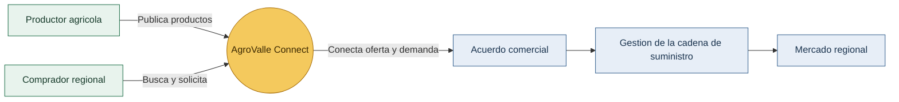
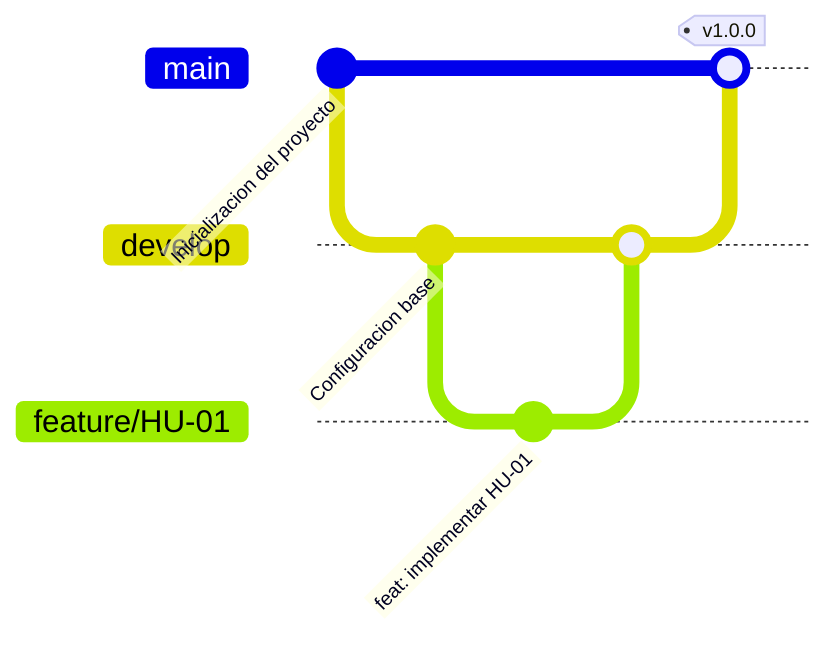

# AgroValle Connect

Plataforma digital para conectar a los productores del Valle del Cauca con mercados regionales y facilitar la comercializacion de productos agricolas.


## Vision del producto

AgroValle Connect integra productores locales, compradores y la cadena de suministro en un solo espacio digital. La plataforma busca mejorar la visibilidad de la oferta agricola, facilitar acuerdos comerciales y optimizar el movimiento de productos desde el campo hasta los mercados regionales.

### Declaracion de la Vision del Producto

> Para **productores del Valle del Cauca**, que **necesitan vender directo** sin depender de intermediarios,
> **AgroValle Connect** es **una plataforma web construida en Java y Spring Boot**
> que **conecta oferta y demanda a precio justo** entre agricultores y compradores regionales.
> A diferencia de **los intermediarios tradicionales de la cadena agricola**,
> nuestro producto **garantiza trazabilidad del pedido y contratos de API transparentes** entre las partes.


## Como funciona

### Aplicacion web

La aplicacion se ejecuta como un solo sitio Spring Boot. La tienda para compradores es la pagina de inicio; el panel de gestion comparte los mismos datos y API:

- `/` o `/clientes.html`: catalogo, carrito y seguimiento local de pedidos.
- `/clientes/`: catalogo con filtros, favoritos y busqueda.
- `/carrito/`: detalle y total del carrito, con checkout PSE.
- `/acceso/`: inicio de sesion para compradores y administradores.
- `/registro/`: formulario independiente para crear una cuenta de comprador.
- `/cuenta/`: edicion de perfil y contraseña.
- `/pedidos/`: seguimiento e historial de pedidos del comprador (requiere sesión).
- `/admin.html`: panel de gestión: resumen de ventas, productores (con contacto) y productos (con ubicación).
- `/api/v1/productos` y `/api/v1/productores`: API REST consumida por ambas vistas.

Ejecuta `./mvnw spring-boot:run` (en Windows, `mvnw.cmd spring-boot:run`) y abre `http://localhost:8080`. El carrito sigue almacenado en el navegador. Las páginas cliente, acceso, registro, cuenta y carrito están organizadas en sus respectivos directorios bajo `static/`.

### Acceso administrativo

Al iniciar, Hibernate crea la tabla `admin` junto con las demás entidades. El inicializador aprovisiona o actualiza el administrador solo si están configurados `AGROVALLE_ADMIN_USER` y `AGROVALLE_ADMIN_PASSWORD`; no hay credenciales predeterminadas en el repositorio. No existe registro público de administradores. La gestión de productores y productos y la ruta `/admin.html` requieren sesión de administrador.

Para desarrollo local, configura las variables privadas en PowerShell antes de iniciar la app. Sin usuario y contraseña configurados, el administrador no se aprovisiona:

```powershell
$env:AGROVALLE_ADMIN_USER = "admin"
$env:AGROVALLE_ADMIN_PASSWORD = "<una-clave-segura>"
$env:AGROVALLE_ADMIN_NOMBRE = "<nombre>"
$env:AGROVALLE_ADMIN_APELLIDO = "<apellido>"
$env:AGROVALLE_ADMIN_CORREO = "<correo>"
.\mvnw.cmd spring-boot:run
```

Si ejecutas desde una terminal que ya tiene Spring Boot iniciado, detenlo y vuelve a arrancarlo para aplicar los cambios de esquema y aprovisionamiento. En `/acceso/` hay un único formulario: el correo inicia sesión como cliente y el usuario administrador como administrador. El botón de PSE usa un checkout hospedado por Wompi y valida el total en servidor; para habilitar transacciones reales configura `WOMPI_PUBLIC_KEY`, `WOMPI_INTEGRITY_SECRET` y `WOMPI_REDIRECT_URL`. El checkout hospedado presenta PSE junto con los métodos habilitados en tu cuenta. Sin esas credenciales, el sitio explica que el pago no está configurado y no simula un cobro.



## Alcance inicial

- Registro y gestión de productores y compradores.
- Publicación y consulta de productos agrícolas.
- Solicitudes de compra y acuerdos comerciales.
- Seguimiento de la cadena de suministro.

## Equipo

| Integrantes |
| --- |
| Juan Chicangana |
| Andres Fuelagan |
| Juan Guerrero |
| Miguel Hurtado |

## Tecnologias

- Java 17
- Spring Boot
- Maven
- PostgreSQL
- Git y GitHub

## Seleccion de Java

El proyecto incluye un selector para cambiar entre las versiones de Java instaladas:

```powershell
. .\scripts\select-java.ps1
```

El selector permite elegir Java 8, 17, 21 o 26 cuando estan disponibles. La version elegida queda activa en la ventana actual de PowerShell. Para validar el proyecto con Java 17, selecciona esa version y ejecuta:

```powershell
.\mvnw.cmd test
```

## Activar los hooks de Husky

Los hooks de `.husky/pre-commit` solo se activan después de instalar las dependencias de Node una vez por clon (requiere Node.js 18+):

```
npm install
```

El script `prepare` de `package.json` ejecuta `husky` y configura `core.hooksPath`. Desde ese momento cada `git commit` corre `./mvnw test` y `./mvnw checkstyle:check`.

## Estrategia de ramas: GitFlow

Se utiliza GitFlow para separar el desarrollo de nuevas funcionalidades de las versiones estables:

- `main`: versiones estables y entregables.
- `develop`: integración de funcionalidades.
- `feature/*`: desarrollo de historias de usuario.
- `fix/*`: correcciones puntuales.

Los cambios se integran mediante Pull Requests revisados por otro integrante del equipo.

**Justificación:** el equipo optó por GitFlow (en lugar de Trunk-Based Development) porque el tamaño del equipo es pequeño, la dedicación es parcial (estudiantes) y el proyecto aún no cuenta con integración continua real. Aislar cada Historia de Usuario en una rama `feature/*` evita romper `develop` con cambios incompletos, y usar `develop` como rama de integración antes de `main` reduce los tiempos de espera entre integrantes: cada quien avanza en su propia rama y solo debe resolver conflictos al abrir el Pull Request, no en cada commit. Las ramas `feature/*` se mantienen deliberadamente cortas (una historia = una rama) para minimizar el riesgo de "Merge Hell" propio de ramas de larga duración.



## Estructura del proyecto

```text
src/main/java/.../modelo        Entidades JPA (Productor, Producto)
src/main/java/.../repositorio   Repositorios Spring Data JPA
src/main/java/.../controlador   Controladores REST
src/test/java                   Pruebas automatizadas
docs/                            Documentación y Definition of Done
BACKLOG.md                       Historias de usuario y prioridades
checkstyle.xml                   Reglas de calidad de código (Google Java Style)
.husky/pre-commit                Validaciones antes de crear commits (tests + Checkstyle)
```

## Documentacion

- [Guia de ejecucion manual](docs/guia-ejecucion.md)
- [Product Backlog](BACKLOG.md)
- [Definition of Done](docs/dod.md)
- [Repositorio público en GitHub](https://github.com/el-Andres-F/agrovalle-connect)
