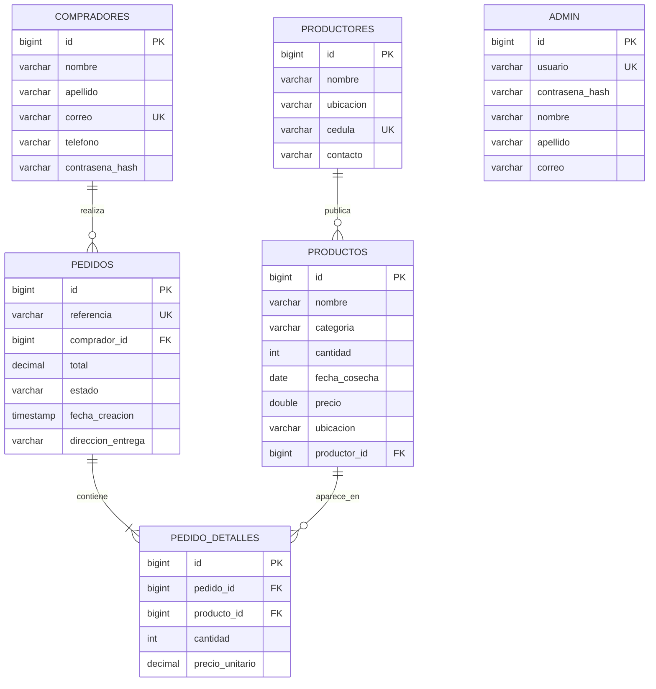

# Diagrama Entidad–Relación (3FN)

La tabla administrativa es independiente de las relaciones de compra. `pedido_detalles` elimina grupos repetidos y conserva cantidad/precio histórico por línea; DDL equivalente en [`schema.sql`](schema.sql).
